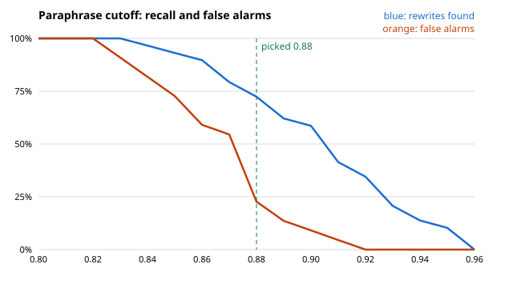

# Calibration of the paraphrase cutoff (X25)

No training is involved. `scripts/calibrate.py` replays 29 labelled rewrites and 22 ordinary
questions through the real pipeline and measures what each cutoff would do.

| Cutoff | Rewrites found | False alarms |
|---|---|---|
| 0.80 | 100% | 100% |
| 0.81 | 100% | 100% |
| 0.82 | 100% | 100% |
| 0.83 | 100% | 91% |
| 0.84 | 97% | 82% |
| 0.85 | 93% | 73% |
| 0.86 | 90% | 59% |
| 0.87 | 79% | 55% |
| 0.88 | 72% | 23% | ← picked
| 0.89 | 62% | 14% |
| 0.90 | 59% | 9% |
| 0.91 | 41% | 4% |
| 0.92 | 34% | 0% |
| 0.93 | 21% | 0% |
| 0.94 | 14% | 0% |
| 0.95 | 10% | 0% |
| 0.96 | 0% | 0% |

**Pick:** 0.88, the highest recall with false alarms at or under
25%. The code uses `PARAPHRASE_COSINE` in
`services/brain/src/brain/documents/registry.py`; change it only after re-running `make calibrate`.

A false alarm sends the message to the local model; it never blocks (PRD 9.3). That is why a
budget of 25% is acceptable. All data is invented. Re-run after changing the
embedding model, the chunking or the document set.
